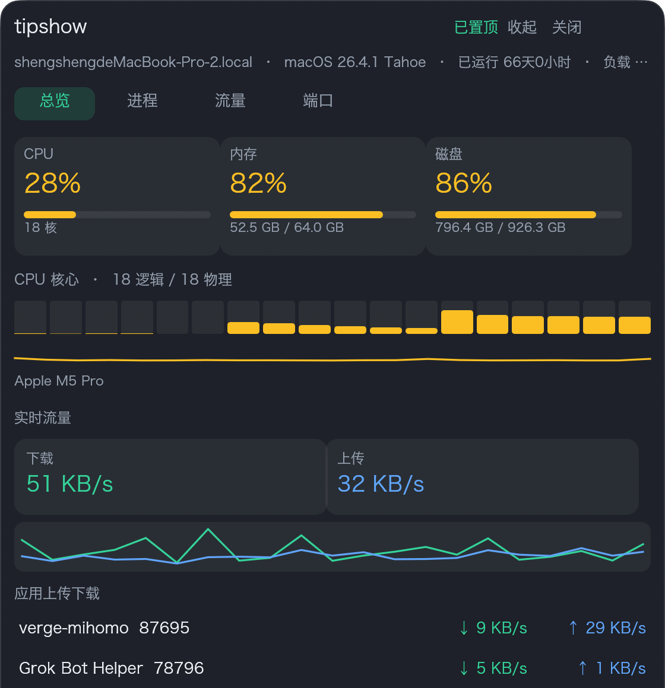
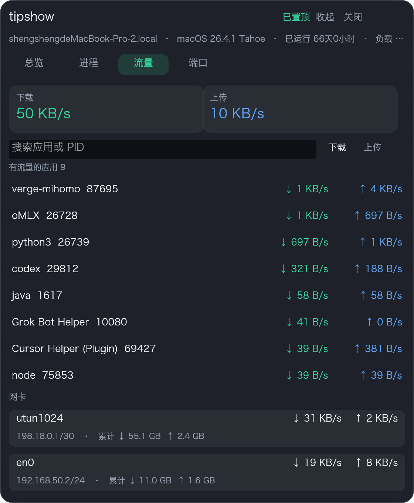
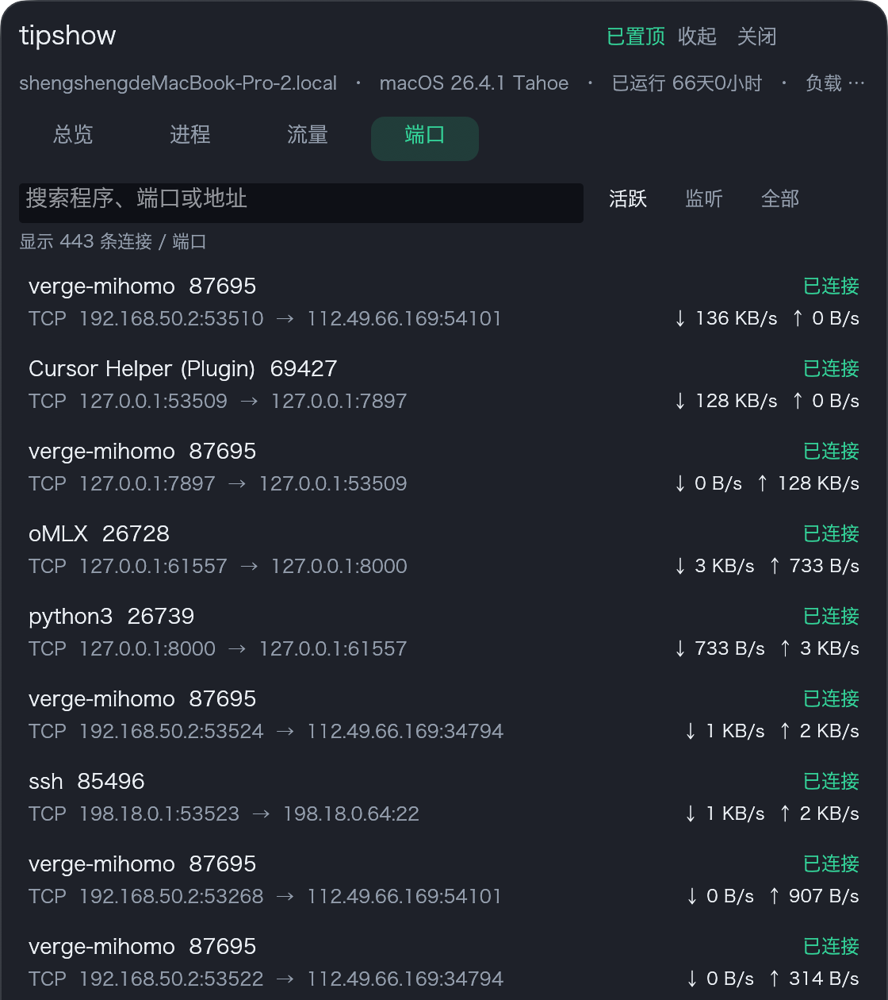

# tipshow

Go 实现的系统监控 CLI 工具包，由浅入深统一封装常见 Linux/macOS 命令，便于统计与分析。

## 安装

```bash
go install ./...
# 或
go build -o bin/tipshow .
```

## 桌面悬浮窗

Rust 版置顶悬浮窗，方便盯着本机状态，不用反复敲命令。收起是一颗网速胶囊（实时上下行、CPU、内存），点击展开后可看进程、每个应用的上传下载、端口对应的程序，以及磁盘。窗口可拖拽，默认置顶。应用流量和端口在 macOS 上通过 `nettop` 采集。

```bash
cd float
cargo run --release
# 启动时直接展开详情
cargo run --release -- --expanded
```

需要本机已安装 Rust。macOS 会加载系统里的黑体/冬青黑，Windows 用微软雅黑，Linux 用 Noto Sans CJK。

### 界面

总览看 CPU、内存、磁盘，以及当前流量最高的应用。



流量页按应用列出上传和下载，下面保留各网卡。



端口页把本地端口、远端地址和对应程序放在一行。



## 快速开始

```bash
# 检测本机可用工具（按 basic → intermediate → advanced 分层）
tipshow doctor

# 基础层：内置 gopsutil，跨平台快照
tipshow host
tipshow cpu
tipshow mem
tipshow disk df
tipshow disk du -p /var/log
tipshow net io

# 中级层：网络连接 / 接口
tipshow net conn
tipshow net if

# 中级/高级：透传外部命令（自动检测是否安装）
tipshow run iostat
tipshow run htop
tipshow run tcpdump -- -i en0 -c 10
```

## 层级说明

| 层级 | 命令 | 说明 |
|------|------|------|
| **basic** | `host` `cpu` `mem` `disk` `net io` | Go 内置采集 + df/du |
| **intermediate** | `net conn` `net if` / `run htop` `iostat` `iotop` `ss` `ip` … | 依赖系统工具 |
| **advanced** | `run sar` `pidstat` `perf` `blktrace` `tcptop` `tcpdump` … | 性能分析与抓包 |

## JSON 输出

所有命令支持 `--json`，便于脚本与后续分析：

```bash
tipshow cpu --json | jq .
tipshow doctor --json
tipshow disk du -p . --json
```

## 本机工具检测 (macOS 示例)

运行 `tipshow doctor` 可查看 ✓/✗ 及安装提示。Linux 服务器通常具备更多高级工具（`sar`、`ss`、`perf` 等）。

## 项目结构

```
.
├── main.go
├── cmd/              # Cobra 子命令
├── internal/
│   ├── collect/      # gopsutil 内置采集
│   ├── tools/        # 外部工具 catalog 与检测
│   ├── runner/       # 安全 exec 封装
│   └── output/       # 文本 / JSON 输出
├── float/            # Rust 桌面悬浮窗
└── docs/screenshots/ # 悬浮窗界面截图
```

## 开发路线

- [ ] 结构化解析 df/du/iostat 输出（非纯透传）
- [ ] 采样历史与简单报表导出
- [ ] Linux 专用 eBPF 工具集成 (tcptop/biotop)
